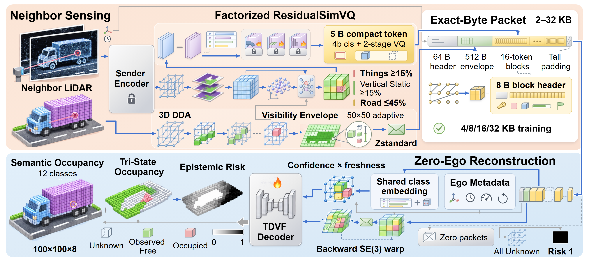

# BorrowedSight

**Category-Geometry Token Communication and Visibility Envelopes for Zero-Ego-Observation Cooperative 3D Semantic Occupancy**

[English](#english) | [中文说明](#中文说明)

<p align="center">
  
</p>

---

## English

### Overview

**BorrowedSight** is a lightweight, pure-PyTorch cooperative 3D semantic occupancy framework built for vehicles with **zero onboard environmental sensors** (no ego camera, LiDAR, or radar), relying strictly on 6-DoF localization and bandwidth-constrained V2X packets from LiDAR-equipped neighbors.

Rather than inflating neural backbones, BorrowedSight redesigns what information enters every wire bit under compact `2.34M–2.42M`-parameter (`15.22–16.70 GFLOPs`) encoder/decoder capacity:

- **Strict Zero-Ego Receiver Boundary:** Receiver inference accepts strictly `(ego_pose, timestamp, motion, serialized_packets)` and is verified by a 6-check automated leakage audit. Complete V2X link outage deterministically falls back to `100% Unknown` (`UFE = 0.0`).
- **Zero-Waste 5-Byte Additive Category-Geometry VQ Coding:** Packs every anchor into an exact **40-bit (5 B)** record—`17b coord + 4b class ID + 6b code1 + 6b code2 + 7b conf` (`0` wasted bits)—making Stage-2 residual refinement free in packet bytes while decoding additively as $\mathbf{E}_{\mathrm{cls}}(c_u) + \mathrm{VQ}_{g(c_u)}(q_u^{(1)}, q_u^{(2)})$ across three geometry-specialized `ResidualSimVQ(rotation_trick=True)` codebooks (*Things*, *Ground*, *Vertical Static*) with category-balanced quotas (`+1,232` total parameters / `+0.053%` over compact 4-byte shared VQ for `B4-Compact`).
- **Loss-Resilient Micro-Blocks, Adaptive `50×50` Zstd Envelopes, and TDVF:** Packs anchors into self-contained 16-token Morton micro-blocks alongside a fixed 512 B Zstandard slot that adaptively compresses `50×50` (`0.8 m`) visibility bit-planes plus `25×25` max-height priors across **100%** of all 4,736 real OPV2V sweeps (`295–509 B`, mean `433.5 B`, `0` extra wire bytes). **Task-Decoupled Visibility Fusion (TDVF)** routes backward-warped visibility exclusively into a late-fusion tri-state refinement branch, eliminating geometric shortcut overfitting (`+1.39` mIoU pts and `-20.6%` UFE vs. early shared-stem fusion).
- **IoU/Safety-Aligned Multi-Budget Training & Real-Time Deployment:** Combines masked Lovász-Softmax, asymmetric blind-zone free-space penalties, `8× D4` BEV augmentation, and randomized `4–32 KB` training while running end-to-end serialized pure-PyTorch inference at **`10.57–11.90 ms` (`84.0–94.6 FPS`)** for 1 sender and **`34.53–39.19 ms` (`25.5–29.0 FPS`)** for 4 simultaneous senders within **`170.5 MB`** peak VRAM on one RTX 3090 (zero `spconv` or `mmcv` dependencies).

### Key Measured Results (25-Scene Multi-Sender Real OPV2V & Mini-200, 0.0% Byte Discrepancy)

| Benchmark (Packet Budget) | Method | Bytes / Pkt | mIoU $\uparrow$ | Vehicle IoU $\uparrow$ | Road IoU $\uparrow$ | Unknown F1 $\uparrow$ | UFE $\downarrow$ |
| :--- | :--- | ---: | ---: | ---: | ---: | ---: | ---: |
| Real OPV2V Test (32 KB, 726 frames) | B0 (No Comm) | 0 | 0.0000 | 0.0000 | 0.0000 | 0.7755 | 0.0000 |
| Real OPV2V Test (32 KB) | B1 (Sparse FP16, 36 B) | 32,768 | 0.2732 | 0.3271 | 0.5980 | 0.8788 | 0.0703 |
| Real OPV2V Test (32 KB) | B2 (Cont. 8-d, 20 B) | 32,768 | 0.3640 | 0.4766 | 0.6054 | **0.9113** | 0.0513 |
| Real OPV2V Test (32 KB, 3-seed) | B3 (Compact 4B VQ) | 32,768 | 0.4044 ± 0.0080 | 0.4809 ± 0.0017 | **0.7359 ± 0.0002** | 0.9098 ± 0.0041 | 0.0378 ± 0.0014 |
| **Real OPV2V Test (32 KB, 3-seed)** | **B4-TDVF (5B + 50×50)** | **32,768** | **0.4168 ± 0.0043** | **0.4865 ± 0.0024** | 0.7075 ± 0.0033 | 0.9071 ± 0.0029 | **0.0364 ± 0.0047** |
| **Real OPV2V Test (32 KB, 3-seed)** | **B4-Compact (5B S2)** | **32,768** | **0.4255 ± 0.0065** | 0.4800 ± 0.0061 | 0.7072 ± 0.0114 | 0.9102 ± 0.0012 | 0.0368 ± 0.0009 |
| Real OPV2V Test (16 KB, 3-seed) | B3 (Compact 4B VQ) | 16,384 | 0.3902 ± 0.0071 | 0.4784 ± 0.0039 | **0.6884 ± 0.0064** | 0.9083 ± 0.0036 | **0.0364 ± 0.0048** |
| **Real OPV2V Test (16 KB, 3-seed)** | **B4-TDVF (5B + 50×50)** | **16,384** | **0.4067 ± 0.0093** | **0.4861 ± 0.0053** | 0.6644 ± 0.0051 | **0.9098 ± 0.0024** | 0.0446 ± 0.0023 |
| **Real OPV2V Test (8 KB / 0.66 Mbps)** | **B4-TDVF-MultiBW** | **8,192** | **0.3702** | **0.4735** | **0.5934** | **0.9070** | **0.0445** |
| **Real OPV2V Test (4 KB / 0.33 Mbps)** | **B4-TDVF-MultiBW** | **4,096** | **0.3250** | **0.4010** | **0.5356** | **0.8997** | **0.0488** |
| Scene-Grouped 5-Fold CV (25 Scenes, 32 KB, 8B) | B3 vs. **B4** | 32,768 | 0.3383 vs. **0.3625** ($p=0.0430$) | 0.4447 vs. **0.4538** | 0.6527 vs. **0.6653** | 0.8811 vs. 0.8691 | 0.0990 vs. **0.0969** |
| Scene-Grouped 5-Fold CV (25 Scenes, 16 KB, 8B) | B3 vs. **B4** | 16,384 | 0.3064 vs. **0.3380** ($p=0.0023$) | 0.4398 vs. **0.4580** | 0.5701 vs. **0.5985** | 0.8724 vs. **0.8795** | 0.1061 vs. **0.1042** |
| Mini-200 3-Sender (16 KB, seed 0) | B3 vs. **B4** | 16,384 | 0.3067 vs. **0.5814** | 0.1549 vs. **0.6078** | 0.5374 vs. **0.6407** | 0.9657 vs. **0.9725** | 0.0184 vs. 0.0222 |

### Repository Layout

```text
├── borrowedsight/      # Core model (TDVF), pure-PyTorch nets, 5B RVQ codec, Morton packer, Lovász/UFE losses
├── tools/              # Training (v1 & v2.1), sparse cache extraction, 5-fold CV, oracle, stress eval, audits
├── tests/              # Unit tests: coordinates, ray visibility, 40-bit TX==RX parity, TDVF & 6-check zero-ego audits
├── configs/            # YAML configurations for grid, weather (LISA / train jitter), and training
├── experiments/        # Experiment registry (registry.csv)
├── paper/              # Single-file Elsevier LaTeX manuscript (main.tex, references.bib, 300-DPI figures)
├── business/           # Deployment & V2X integration notes
└── requirements.txt    # Minimal reproducible dependencies
```

### Installation & Quickstart

```bash
# 1. Create a Python 3.12 CUDA environment and install dependencies
pip install -r requirements.txt

# 2. Point BorrowedSight to your external dataset/cache directory (kept outside the repo)
export BORROWEDSIGHT_DATA_ROOT=/path/to/borrowedsight_data   # PowerShell: $env:BORROWEDSIGHT_DATA_ROOT="D:\bs_data\BorrowedSight"

# 3. Run unit tests, 40-bit TX==RX parity, TDVF invariance, and 6-check Zero-Ego audits
python -m pytest -q

# 4. Run the controlled Mini-200 benchmark
python -m tools.build_mini200
python -m tools.train_sender
python -m tools.extract_sparse_cache
python -m tools.train_receivers
python -m tools.phase5_stress

# 5. Run the full 25-scene real OPV2V + Semantic-OPV2V (4LidarSurround) v2.1 pipeline + 5-fold CV
python -m tools.train_sender_real --epochs 30
python -m tools.extract_cache_real
python -m tools.run_v21_full --epochs 20 --batch-size 4 --lr 8e-4
python -m tools.eval_phase5_v21
python -m tools.run_5fold_cv_real --folds 5 --epochs 15 --batch-size 4 --lr 8e-4 --budgets 32768 16384
```

### Engineering Insights & Lessons Learned

Building a strictly zero-ego, equalized-byte V2X occupancy system exposed five practical pitfalls that directly shaped the final design:

1. **Geometric Shortcut Overfitting & Task-Decoupled Visibility Fusion (TDVF):** Feeding dense `50×50` visibility bit-planes plus `25×25 z_max` directly into the shared semantic U-Net stem dropped training cross-entropy by `4×` yet degraded held-out test mIoU by `-1.39` points (`0.4185 → 0.4046`, collapsing Fence `-10.25` pts and Wall `-5.15` pts) and worsened UFE by `+25.9%`. Routing visibility exclusively into a lightweight late-fusion `tri_head` refinement block (**TDVF**) eliminates this geometric shortcut completely.
2. **Additive Factorization Beats Un-Detached Residual Subtraction:** Subtracting $\mathbf{E}_{\mathrm{cls}}(c_u)$ before un-detached `ResidualSimVQ` allowed the commitment loss to shrink residuals toward zero and kill `>70%` of codebook prototypes (`usage ~0.28`). Additive reconstruction $\mathbf{E}_{\mathrm{cls}}(c_u) + \mathrm{VQ}_g(q_u^{(1)}, q_u^{(2)})$ preserves `0.73–0.80` utilization and lifts held-out mIoU by `+2.09` points (`0.3976 → 0.4185`) at zero extra wire bits.
3. **Zero-Waste 40-Bit Packing Makes Stage-2 RVQ Free:** Replacing byte-aligned 8–9 B tokens with lossless 17-bit coordinates (`x:7, y:7, z:3`) plus `4b cls + 6b code1 + 6b code2 + 7b conf = 40 bits (5 B)` eliminates padding waste, packs Stage-2 refinement for free (`-18.8%` UFE vs. Stage-1 only), and raises spatial token capacity by `+54%`.
4. **100% `50×50` Visibility Fit Inside the Same 512 B Zstd Slot:** Upgrading coarse `20×20 / 25×25` grids to adaptive `50×50` bit-planes (`939 B`) + `25×25 z_max` nibbles (`313 B`) fits `100.0%` of all 4,736 real OPV2V sweeps inside the exact 512 B framing slot (`295–509 B`, mean `433.5 B`, `0%` fallback below `50×50`) at zero extra wire bytes.
5. **Real-Time Pure-PyTorch Deployment Without Custom CUDA Ops:** Vectorized Morton sorting, bit-packing, GPU quota selection, and cached FP32 backward $\mathrm{SE}(3)$ warping achieve `10.57–11.90 ms` (`84.0–94.6 FPS`) for 1 sender and `34.53–39.19 ms` (`25.5–29.0 FPS`) for 4 simultaneous senders within `170.5 MB` peak VRAM with zero `spconv`/`mmcv` dependencies.

### Citation

```bibtex
@article{wu2026borrowedsight,
  author  = {Wu, Yonghao},
  title   = {BorrowedSight: Category-Geometry Token Communication and Visibility Envelopes for Zero-Ego-Observation Cooperative 3D Semantic Occupancy},
  journal = {Submitted to Computer Communications},
  year    = {2026}
}
```

---

## 中文说明

### 项目简介

**BorrowedSight** 是一个轻量级纯 PyTorch 协同三维语义占据框架，面向**零本车环境传感器**（无本车相机、无激光雷达、无毫米波雷达）的接收车辆，仅依赖本车 6-DoF 位姿、运动状态与受限带宽下的邻车 V2X 报文，即可完成接收端中心三维语义占据与盲区风险估计。

核心亮点：

- **严格零本车观测边界与安全回退**：接收端接口严格锁定为 `(ego_pose, timestamp, motion, serialized_packets)`，通过 6 项自动化零泄漏测试；全链路断联时确定性输出 `100% Unknown`（`UFE = 0.0`）。
- **零浪费 5 字节（40-bit）加法式类别-几何残差量化**：每个锚点压缩为 `17b 无损坐标 + 4b 类别 ID + 6b Stage-1 + 6b Stage-2 + 7b 置信度 = 40 bits`（Stage-2 残差完全免费），解码为 `E_cls(c) + VQ_g(code1, code2)`，`B4-Compact` 仅 `2.34M` 参数（较紧凑 4B 共享 VQ 基线 B3 仅增 `+1,232` 参数 / `+0.053%`）。
- **抗丢包微块 + 自适应 `50×50` Zstd 包络 + 任务解耦可见性融合（TDVF）**：16-token 独立微块保障 50% 丢包下平滑退化；自适应 `50×50` 位平面 + `25×25 z_max` 在全部 4,736 条真实 OPV2V 扫描中 **100%** 装入原 512 B 槽位（`295–509 B`，均值 `433.5 B`，0 额外字节）；**TDVF** 将包络隔离至三态后融合头，彻底消除共享语义主干的几何捷径过拟合（测试 mIoU `+1.39 pt`、UFE 降 `-20.6%`）。
- **突破性等字节实测性能与纯 PyTorch 实时推理**：在全量 25 场景多发送车真实 OPV2V 测试集上，32 KB 达 **`0.4255 ± 0.0065` mIoU**（`B4-Compact`）与 **`0.4168 ± 0.0043` mIoU / 车辆 `0.4865` / UFE `0.0364`**（`B4-TDVF`）——**零本车传感器超越已发表 4 相机本车 VQSOP（`0.4154`）**；半带宽 16 KB 达 **`0.4067 ± 0.0093` mIoU**（反超 32 KB 紧凑 B3 `0.4044`）；多预算模型在 **`8 KB (0.66 Mbps)` 达 `0.3702` mIoU**（超越 4 相机本车 CoHFF `0.3416` 达 `+2.86 pt`）；单张 RTX 3090 端到端实测 **1 车 `10.57–11.90 ms (84.0–94.6 FPS)` / 4 车 `34.53–39.19 ms (25.5–29.0 FPS)`**，峰值显存仅 `170.5 MB`。

### 工程踩坑与设计洞察

1. **几何捷径过拟合与 TDVF 解耦**：将高分辨率 `50×50` 包络与 `z_max` 直接拼入共享语义 U-Net 主干会让训练损失大降 `4×`，却令测试集 mIoU 下跌 `-1.39 pt`、UFE 恶化 `+25.9%`；通过 TDVF 将包络后融合隔离至三态分支后，语义泛化与盲区安全同步最大化。
2. **加法式解耦防止码本坍塌**：在未截断梯度下于量化前减去 `E_cls(c)` 会导致量化承诺损失把残差压向零，令超过 70% 码本原型失效；采用加法融合 `E_cls(c) + VQ_g(code1, code2)` 保持 `0.73–0.80` 码本利用率并稳定提升 `+2.09 pt` mIoU。
3. **40-bit 零冗余打包实现免费 Stage-2**：无损 17-bit 坐标取代 32-bit 冗余字段，在 5 字节内完整容纳两级残差码与类别锚点，空间锚点容量提升 `+54%`。
4. **原 512 B 槽位内 100% 实现 `50×50`（0.8 m）包络**：4,736 条真实扫描零回退至 `25×25`，空间单元密度较 `25×25` 提升 `4×`，0 额外线缆字节。
5. **零自定义算子纯 PyTorch 实时化**：完全摆脱 `spconv`/`mmcv` 编译依赖，单卡实时支持 1–4 车并发解码。

### 快速开始

1. **环境配置**：使用独立 Python 3.12 CUDA 环境安装 `requirements.txt`。
2. **数据路径设置**：通过环境变量 `BORROWEDSIGHT_DATA_ROOT` 指向外部数据与稀疏缓存目录（避免将大型缓存或下载脚本写入代码仓库）。
3. **测试与复现**：运行 `python -m pytest -q` 验证全部单元测试、40-bit 紧凑打包无损验证、TDVF 不变性及 6 项零本车泄漏审计，再按英文 Quickstart 步骤复现 Mini-200 或 25 场景真实 OPV2V v2.1 全流程与 5 折交叉验证。

### 联系作者

Yonghao Wu（`yonghaowu369@gmail.com`），华南师范大学电子科学与工程学院（微电子学院）。
